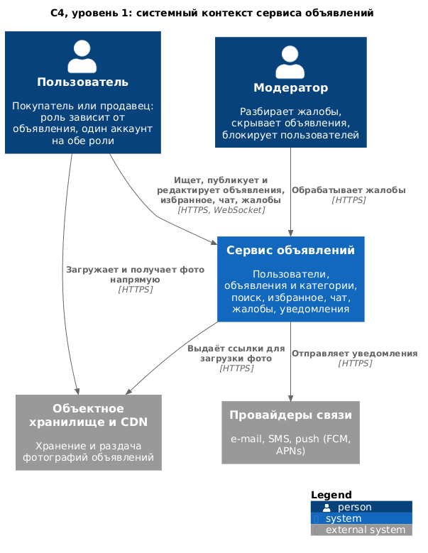
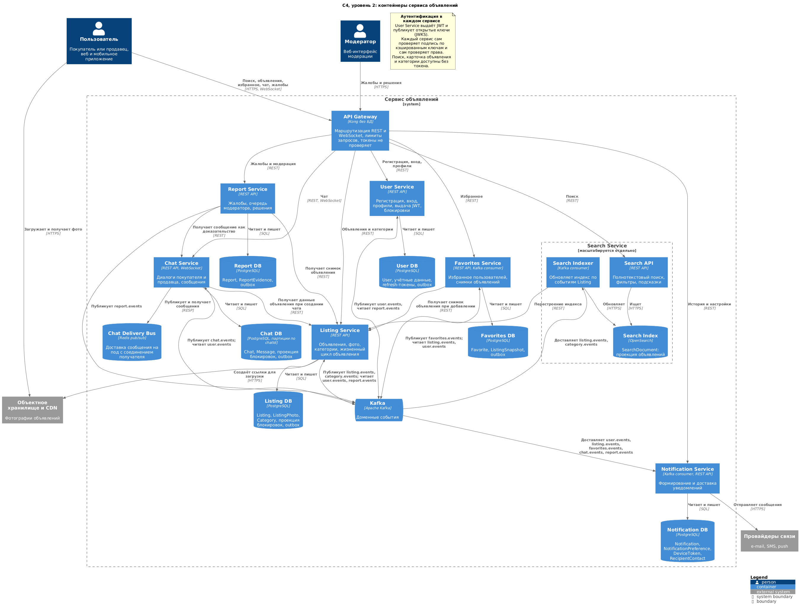
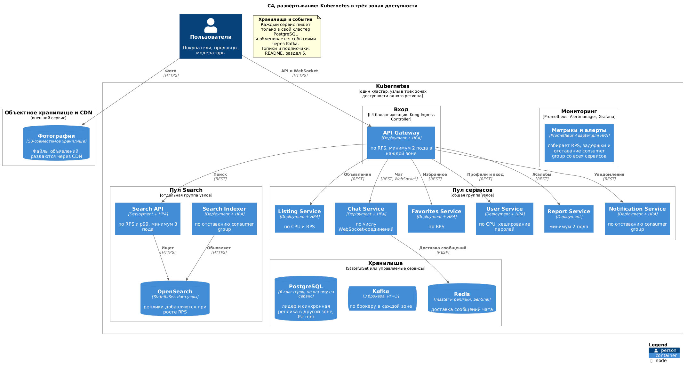

# ADR-001. Декомпозиция по bounded contexts на семь сервисов, поиск выделен отдельно

**Статус:** принято
**Дата:** 2026-11-03

## Контекст проблем

Монолит сервиса объявлений нужно разделить так, чтобы выполнялись ограничения варианта 1112: явный владелец данных у каждой бизнес-области, независимое развёртывание частей, изоляция отказов, отдельное масштабирование поиска, работа трёх команд при 5 000 RPS и 5 млн пользователей.

Единое приложение мешает выполнить их по следующим причинам:

- **Нагрузка неравномерна.** По оценке из [отчёта](README.md#1-исходные-данные-и-допущения), поиск даёт около 50 % запросов, а публикация объявлений всего около 12 RPS в пик. Масштабировать приходится всё приложение целиком, хотя индекс поиска и транзакционная часть требуют разных ресурсов.
- **Сбои не изолированы.** Тяжёлый поисковый запрос или всплеск сообщений в чате может замедлить публикацию объявлений и вход пользователей.
- **Данные без владельца.** Общая БД позволяет любому модулю менять чужие таблицы, а изменение схемы приходится согласовывать со всеми.
- **Общий цикл релизов.** Три команды зависят от одного развёртывания, а исправление в модерации ждёт релиза поиска.

Нужно решить, по каким границам делить систему и сколько сервисов создать.

## Рассмотренные альтернативы

### Альтернатива A. Сервис на сущность

Восемь сервисов по списку сущностей: User, Listing, Category, Favorite, Chat, Message, Report, Notification (поиск как девятый, если считать его отдельно).

Границы очевидны. Но Chat и Message нельзя разделить без распределённой транзакции: каждое сообщение требует проверки диалога и участников. Category нужна при каждой публикации и редактировании объявления для проверки атрибутов, то есть появляется постоянный синхронный вызов Listing → Category. Цепочка из трёх сервисов с доступностью 99,9 % даёт 0,999³ ≈ 99,7 %, то есть около 26 часов простоя в год вместо 9. Восемь-девять сервисов на три команды означают по три сильно связанных сервиса на команду.

### Альтернатива B. Модульный монолит и отдельный Search

Две единицы развёртывания: монолит с модулями User, Listing, Favorites, Chat, Report, Notification и отдельный Search.

Самый дешёвый вариант в эксплуатации. Сохраняются ACID-транзакции, нет саг, выполняется главное требование про отдельное масштабирование поиска. Но WebSocket-нагрузка чата и публикация объявлений масштабируются только вместе, сбой любого модуля затрагивает всё остальное, три команды остаются в общем релизе, а владение данными держится на соглашениях внутри одной БД. Требование про независимое развёртывание выполняется только для поиска.

### Альтернатива C. Семь сервисов по bounded contexts (выбрана)

User, Listing (с Category), Search, Favorites, Chat (с Message), Report, Notification. У каждого сервиса своя БД, взаимодействие в основном через события Kafka.

## Сравнение

| Критерий | A. Сервис на сущность | B. Монолит + Search | C. Семь сервисов |
|---|---|---|---|
| Отдельное масштабирование поиска | да | да | да |
| Независимое развёртывание | да | только Search | да |
| Изоляция отказов | длинные синхронные цепочки снижают доступность | один домен отказа на шесть модулей | сбой Chat, Favorites, Report, Notification не затрагивает публикацию и поиск |
| Владение данными | формальное, инварианты разорваны (Chat и Message, Listing и Category) | по соглашению, общая БД | явное, БД у каждого сервиса |
| Работа трёх команд | 8–9 сервисов, сильная связанность | общий релиз у двух команд из трёх | 7 сервисов: 2, 3 и 2 на команду |
| Сложность эксплуатации | самая высокая | самая низкая | высокая |
| Согласованность данных | саги внутри одной операции | ACID внутри монолита | ACID внутри агрегата, итоговая согласованность между контекстами |

## Выбранное решение

Система делится на семь сервисов, границы проходят по bounded contexts:

- **Listing и Category** объединены, потому что категория задаёт схему атрибутов объявления и проверяется при каждой публикации. Категории меняются редко и хорошо кэшируются.
- **Chat и Message** объединены: сообщение не существует без диалога, а проверка участников и запись сообщения должны быть атомарны.
- **Search** выделен как отдельный сервис с собственным хранилищем (OpenSearch) и тремя независимо масштабируемыми частями: API, Indexer, узлы индекса.
- **User, Favorites, Report, Notification** выделены как самостоятельные контексты.

Распределение по командам: **Marketplace** ведёт Listing и Search, **Engagement** ведёт Chat, Favorites и Notification, **Trust & Platform** ведёт User и Report, а также шлюз, Kafka и мониторинг.

Взаимодействие строится так:

- Состояние передаётся событиями Kafka через Transactional Outbox: объявление попадает в индекс, избранное и уведомления по событиям `listing.events`, решение модератора применяется по `report.events`.
- Синхронный REST используется, только если ответ нужен немедленно и затрагивает один редкий сценарий: создание чата, добавление в избранное, подача жалобы. Во всех трёх случаях при недоступности Listing предусмотрена деградация (отказ создания чата или статусы `SNAPSHOT_PENDING` и `PENDING_EVIDENCE`).
- Аутентификация без обращения к User Service на каждый запрос: сервисы проверяют JWT локально, а поиск, карточка и категории доступны без токена.

## Обоснование выбора

1. **Выполняется требование про отдельное масштабирование поиска.** У Search своя БД, свой пул узлов и своя метрика масштабирования. Нагрузка на поиск не отнимает ресурсы у публикации и чата.
2. **Границы совпадают с транзакционными инвариантами.** Публикация объявления с категорией, отправка сообщения в диалог, добавление в избранное остаются внутри одного сервиса и одной БД. Альтернатива A этого не обеспечивает.
3. **Отказ одного компонента не останавливает систему.** Около 74 % трафика (поиск и чтение объявлений) вообще не зависит от User, Chat, Favorites, Report и Notification. Сбой Search оставляет карточки, чат и избранное, а сбой Listing оставляет поиск по существующему индексу (см. таблицу отказов в [отчёте](README.md#5-основные-взаимодействия)). В альтернативе B этого нет.
4. **Число сервисов соответствует числу команд.** Два, три и два сервиса на команду. Самый нагруженный Search вместе со своим источником данных Listing у одной команды, поэтому изменение формата индекса не требует межкомандной координации.
5. **Модерация и пользователи отделены от основного потока.** Report и User работают с чувствительными данными и отдельными ролями, их сбой не останавливает публикацию.

Альтернатива B дешевле и была бы лучшим выбором для одной небольшой команды. Здесь решающими оказались требования к независимому развёртыванию и изоляции отказов и наличие трёх команд.

## Последствия

### Положительные

- Поиск масштабируется независимо: API по RPS, индексатор по отставанию, индекс добавлением реплик.
- Отказ Chat, Favorites, Report или Notification не мешает публиковать и искать объявления.
- У каждой сущности один владелец, схему БД можно менять независимо.
- Команды выпускают релизы независимо, координация нужна только при изменении контрактов.
- Новый потребитель событий подключается без изменения существующих сервисов (например, рекомендации или аналитика).

### Отрицательные

- Согласованность между контекстами становится итоговой: объявление появляется в поиске, а скрытое объявление пропадает из него с задержкой в секунды.
- Индекс может разойтись с источником истины, поэтому нужна ежесуточная сверка и перестроение индекса из выгрузки Listing.
- Kafka становится критичной инфраструктурой, а отдельной платформенной команды нет.
- Контракты событий требуют версионирования и проверки совместимости.
- Часть данных дублируется (проекции в Favorites, Chat, Notification), включая минимальные персональные данные в Notification.
- JOIN между контекстами невозможен, для сквозной аналитики нужна отдельная витрина.
- Растут затраты на инфраструктуру и наблюдаемость: 7 сервисов, 6 кластеров PostgreSQL, OpenSearch, Kafka, Redis.

Меры по снижению этих рисков перечислены в [разделе 10 отчёта](README.md#10-потенциальные-проблемы).

## Итоговая архитектурная схема (C4)

### Уровень 1. Системный контекст

Исходник: [diagrams/c4-context.puml](diagrams/c4-context.puml).

### Уровень 2. Контейнеры

Исходник: [diagrams/c4-container.puml](diagrams/c4-container.puml).

### Развёртывание

Система работает в одном кластере Kubernetes с узлами в трёх зонах доступности. Search вынесен в отдельный пул узлов, чтобы нагрузка поиска не отнимала ресурсы у остальных сервисов. Число подов каждого развёртывания меняет HPA по своей метрике. Подробности в [разделах 8 и 9 отчёта](README.md#8-независимое-развёртывание-и-масштабирование).

Исходник: [diagrams/c4-deployment.puml](diagrams/c4-deployment.puml).
