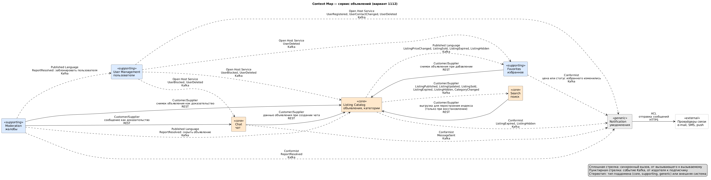

# Лабораторная работа №1. Декомпозиция системы на микросервисы

Вариант 1112: сервис объявлений, платформа публикации объявлений о продаже товаров между пользователями.

## Артефакты для сдачи

| Артефакт | Файл |
|---|---|
| Context Map | [diagrams/context-map.puml](diagrams/context-map.puml) |
| Каталог микросервисов | [services.md](services.md) |
| ADR-001 | [ADR-001-decomposition.md](ADR-001-decomposition.md) |
| Схема C4 | [diagrams/c4-context.puml](diagrams/c4-context.puml), [diagrams/c4-container.puml](diagrams/c4-container.puml), [diagrams/c4-deployment.puml](diagrams/c4-deployment.puml) |

Сборка картинок: `plantuml -charset UTF-8 -tpng diagrams/*.puml`

## 1. Исходные данные и допущения

Из задания: 5 млн, 5 000 RPS, 3 команды разработки. Ограничения: явное владение данными, независимое развёртывание, изоляция отказов, отдельное масштабирование поиска.

В задании нет следующих данных, поэтому приняты допущения:

- **«5 млн»** указано без единицы измерения. Считаю, что это 5 млн зарегистрированных пользователей.
- **5 000 RPS** считаю суммарным пиком на внешний API.
- **10 % пользователей заходят в сутки** (500 тыс.), основной сценарий у них — просмотр ленты и поиск.
- **100 000 новых объявлений в сутки**: 2 % пользователей публикуют объявление каждый день, пик в 10 раз выше среднего, около 12 RPS на создание.
- **3 млн активных объявлений**, срок жизни объявления 30 дней, в среднем 8 фотографий.
- **150 тыс. пользователей в сутки пишут в чат**, по 20 сообщений: 3 млн сообщений в сутки, около 350 RPS в пик.
- **Вне варианта**: оплата, доставка товара и отзывы о продавцах не рассматриваются.

Оценка распределения нагрузки:

| Операция | Сервис | RPS | Основание |
|---|---|---:|---|
| Поиск и выдача по категориям | Search | 2 500 | основной сценарий: лента, фильтры, текстовый поиск |
| Карточка объявления, категории, свои объявления | Listing | 1 200 | около 30 RPS из них запись |
| Отправка сообщений и история | Chat | 500 | доставка по WebSocket в RPS не входит |
| Избранное | Favorites | 300 | отметки в выдаче, список избранного |
| Вход, обновление токенов, профили | User | 250 | |
| История и настройки уведомлений | Notification | 200 | сама рассылка идёт из Kafka и в RPS не входит |
| Жалобы и очередь модератора | Report | 50 | |
| **Итого** | | **5 000** | |

Главный вывод: поиск даёт около 50 % запросов, а вместе с чтением карточек около 74 %. Это чтение каталога, которое не требует токена и не зависит от остальных сервисов, поэтому поиск нужно масштабировать и изолировать отдельно.

Объём данных:

- **Фотографии:** 3 млн × 8 × 300 КБ ≈ 7 ТБ в объектном хранилище, раздаются через CDN. Это самый большой объём в системе.
- **Поисковый индекс:** 3 млн × 3 КБ ≈ 10 ГБ, с репликами несколько десятков ГБ. Индекс небольшой, поэтому узкое место поиска — RPS, а не объём.
- **Сообщения:** 3 млн × 300 Б ≈ 1 ГБ в сутки, около 330 ГБ в год.
- **Уведомления:** около 1,5 млн в сутки, история хранится 90 дней.

## 2. Bounded contexts

| Контекст | Сервис | Тип поддомена | Бизнес-возможности | Сущности |
|---|---|---|---|---|
| Listing Catalog | Listing Service | core | объявления, категории | Listing, Category |
| Search | Search Service | core | поиск | SearchDocument (проекция) |
| Chat | Chat Service | core | чат | Chat, Message |
| User Management | User Service | supporting | пользователи | User |
| Favorites | Favorites Service | supporting | избранное | Favorite |
| Moderation | Report Service | supporting | жалобы | Report |
| Notification | Notification Service | generic | уведомления | Notification |

Все восемь сущностей из задания распределены по контекстам. Одно и то же понятие в разных контекстах значит разное, и это подтверждает границы:

- **Listing** в Listing Catalog — полное объявление с фотографиями и атрибутами. В Search — плоский документ для поиска. В Favorites — снимок (название, цена, превью, статус). В Chat — тема диалога. В Moderation — доказательство в жалобе.
- **User** в User Management — аккаунт с учётными данными и статусом. В Chat — участник диалога. В Notification — получатель с контактами и настройками. В Listing Catalog — только идентификатор продавца.

## 3. Context Map

Исходник: [diagrams/context-map.puml](diagrams/context-map.puml).

| Upstream | Downstream | Паттерн | Механизм | Назначение |
|---|---|---|---|---|
| Listing | Chat | Customer/Supplier | REST | данные объявления и продавец при создании чата |
| Listing | Favorites | Customer/Supplier, Published Language | REST, Kafka | снимок при добавлении, затем изменения цены и статуса |
| Listing | Report | Customer/Supplier | REST | снимок объявления как доказательство |
| Chat | Report | Customer/Supplier | REST | сообщение как доказательство |
| Listing | Search | Customer/Supplier | Kafka, REST | наполнение и обновление индекса, выгрузка для перестроения при восстановлении |
| Report | Listing, User | Published Language | Kafka | решение модератора: скрыть объявление, заблокировать пользователя |
| User | Listing, Chat, Favorites, Notification | Open Host Service | Kafka | блокировка и удаление пользователя, контакты |
| Listing, Favorites, Chat, Report | Notification | Conformist | Kafka | поводы для уведомлений |
| Notification | Провайдеры связи | ACL | HTTPS | отправка e-mail, SMS, push |

## 4. Границы сервисов, ответственность и владение данными

На каждый контекст приходится один сервис. Подробное описание находится в [каталоге](services.md).

| Сервис | Ответственность | Данные | Хранилище | Команда-владелец |
|---|---|---|---|---|
| Listing | объявление, фото, категории | Listing, ListingPhoto, Category | PostgreSQL, объектное хранилище | Marketplace |
| Search | поиск и индекс | SearchDocument | OpenSearch | Marketplace |
| Chat | диалоги и сообщения | Chat, Message | PostgreSQL, Redis | Engagement |
| Favorites | избранное | Favorite, ListingSnapshot | PostgreSQL | Engagement |
| Notification | доставка уведомлений | Notification, NotificationPreference, DeviceToken | PostgreSQL | Engagement |
| User | аккаунты, вход, JWT | User, Credential, RefreshToken | PostgreSQL | Trust & Platform |
| Report | жалобы и модерация | Report, ReportEvidence, ModerationDecision | PostgreSQL | Trust & Platform |

Правило владения: данные меняет только сервис-владелец, общих БД и чтения чужих таблиц нет. Копии чужих данных (снимки в Favorites и Chat, контакты в Notification, список блокировок в Listing и Chat, индекс в Search) строятся из событий или запросов и не считаются источником истины.

Семь сервисов распределены на три команды: Marketplace (2 сервиса), Engagement (3 сервиса) и Trust & Platform (2 сервиса). Search и Listing у одной команды, потому что формат индекса меняется вместе с моделью объявления. В Engagement собраны сервисы взаимодействия пользователей. Команда Trust & Platform ведёт два небольших сервиса и берёт на себя общую инфраструктуру: шлюз, Kafka и мониторинг. Отдельной платформенной команды в варианте нет.

**Точка входа.** Внешний трафик проходит через единый API Gateway (Kong без БД): маршруты описаны ресурсами Kubernetes в git, поэтому экземпляры не хранят состояния. Шлюз маршрутизирует REST и WebSocket-соединения чата и ограничивает частоту запросов отдельно по маршрутам: у поиска и чата свои лимиты. Токены шлюз не проверяет. Фотографии загружаются клиентом напрямую в объектное хранилище по временной ссылке от Listing и раздаются через CDN, поэтому 7 ТБ трафика не идут через сервисы.

**Аутентификация.** Каждый сервис проверяет токен сам.

- User Service выдаёт JWT: access-токен на 15 минут и refresh-токен. Открытые ключи публикуются по JWKS.
- Сервис проверяет подпись по ключам, которые кэширует у себя. К User Service на каждый запрос он не обращается, поэтому его сбой не останавливает пользователей с действующим токеном.
- Поиск, карточка объявления и категории доступны без токена. Это около 74 % трафика, и для них User Service вообще не нужен.
- Права проверяет сам сервис: продавец меняет только свои объявления, участник видит только свои диалоги, очередь жалоб доступна только роли MODERATOR.
- Внутренние REST-вызовы идут с токеном вызывающего сервиса, внутренняя сеть доверенной не считается.

## 5. Основные взаимодействия

Правило выбора: синхронный REST используется, только если ответ нужен немедленно. Всё остальное передаётся событиями Kafka через Transactional Outbox.

**Жизненный цикл объявления:**

1. Продавец создаёт черновик: `POST /listings`. Фотографии загружаются по ссылке из `POST /listings/{id}/photos/upload-url` напрямую в объектное хранилище.
2. Продавец публикует объявление: `POST /listings/{id}/publish`. Listing проверяет атрибуты по схеме категории, проверяет, что продавец не заблокирован (своя проекция из `user.events`), переводит объявление в `ACTIVE` и публикует `ListingPublished`.
3. Search Indexer получает событие и обновляет индекс. Цель: объявление видно в поиске не позже чем через 5 секунд.
4. Покупатель ищет: `GET /search`. Search API читает только свой индекс и возвращает поля для списка (название, цена, превью, город). Карточка открывается через `GET /listings/{id}`.
5. Покупатель добавляет объявление в избранное: `POST /favorites`. Favorites берёт снимок объявления у Listing. При изменении цены Listing публикует `ListingPriceChanged`, Favorites обновляет снимок и публикует `FavoritedListingPriceChanged`, Notification отправляет уведомление.
6. Покупатель пишет продавцу: `POST /chats`. Chat запрашивает у Listing продавца и название, сохраняет снимок и создаёт диалог. Сообщения идут по WebSocket, а если получатель не в сети, `MessageSent` без текста превращается в push.
7. Через 30 дней Listing переводит объявление в `EXPIRED` и публикует событие. Search удаляет его из индекса, Favorites помечает снимки, Notification сообщает продавцу.

**Жалобы и модерация:**

1. Пользователь отправляет жалобу: `POST /reports` с типом объекта (`LISTING`, `USER`, `MESSAGE`). Report запрашивает у владельца снимок объекта и сохраняет его как доказательство.
2. Модератор берёт жалобу в работу и принимает решение: `POST /moderation/reports/{id}/resolve`.
3. Report публикует `ReportResolved` с действием. Listing скрывает объявление (`HIDDEN`) и публикует `ListingHidden`, а Search убирает его из индекса. User блокирует пользователя и публикует `UserBlocked`, после чего Listing скрывает все его объявления, а Chat запрещает отправку.
4. Notification сообщает автору жалобы и владельцу объекта о решении.

**Топики Kafka:**

| Топик | Издатель | Подписчики | События | Ключ |
|---|---|---|---|---|
| `user.events` | User | Listing, Chat, Favorites, Notification | `UserRegistered`, `UserContactChanged`, `UserBlocked`, `UserUnblocked`, `UserDeleted` | `userId` |
| `listing.events` | Listing | Search, Favorites, Notification | `ListingPublished`, `ListingUpdated`, `ListingPriceChanged`, `ListingSold`, `ListingExpired`, `ListingArchived`, `ListingHidden` | `listingId` |
| `category.events` | Listing | Search | `CategoryChanged` | `categoryId` |
| `favorites.events` | Favorites | Notification | `FavoritedListingPriceChanged`, `FavoritedListingSold` | `userId` |
| `chat.events` | Chat | Notification | `MessageSent` (без текста) | `chatId` |
| `report.events` | Report | Listing, User, Notification | `ReportResolved` | `reportId` |

**Поведение при отказах:**

| Что отказало | Что продолжает работать | Как проявляется |
|---|---|---|
| Search (API) | карточки по ссылке, избранное, чат, публикация, жалобы | поиск и лента недоступны, клиент показывает избранное и последние просмотры |
| Search Indexer или Kafka | поиск по существующему индексу | новые и изменённые объявления появляются позже, события ждут в Kafka и применяются после восстановления |
| Listing | поиск по индексу, чат, избранное, жалобы | карточки и публикация недоступны, новые чаты не создаются (503), существующие диалоги работают, избранное сохраняется как `SNAPSHOT_PENDING`, жалобы как `PENDING_EVIDENCE` |
| User | поиск, карточки, чат, избранное для пользователей с действующим токеном и для гостей | вход и регистрация недоступны, токены не обновляются, блокировки ждут в Kafka |
| Chat | поиск, публикация, избранное, жалобы на объявления | сообщения не отправляются, жалобы на сообщения в статусе `PENDING_EVIDENCE` |
| Favorites | всё остальное | избранное недоступно, снимки догоняют события после восстановления |
| Report | всё остальное | новые жалобы не принимаются, принятые решения не теряются |
| Notification | всё остальное | уведомления приходят с задержкой, но не теряются |
| Kafka | чтение везде, запись в БД сервисов | события копятся в outbox, индекс и уведомления встают, REST продолжает работать |
| API Gateway | ничего снаружи | экземпляры работают во всех трёх зонах |
| Лидер PostgreSQL одного сервиса | все остальные сервисы | запись в этот сервис недоступна до 1 мин, Patroni переключается на синхронную реплику |
| Узел OpenSearch | поиск | запросы идут в оставшиеся реплики индекса |

## 6. Обоснование декомпозиции

Границы определялись по четырём признакам: транзакционные инварианты, профиль нагрузки, причины изменений и тип хранилища.

| Вопрос о границе | Решение | Почему |
|---|---|---|
| Listing и Category | вместе | категория задаёт схему атрибутов и проверяется при каждой публикации, меняется редко, отдельный сервис добавил бы синхронный вызов в каждую публикацию |
| Listing и Search | раздельно | 2 500 против 1 200 RPS, полнотекстовый индекс против транзакционных данных, разные БД и профиль масштабирования, прямое требование варианта |
| Chat и Message | вместе | сообщение не существует без диалога, проверка участников и запись должны быть атомарны |
| Chat и Listing | раздельно | WebSocket и поток записи против каталога, разные метрики масштабирования, приватность переписки |
| Favorites отдельно от Listing и User | отдельно | это связь «пользователь — объявление» с миллионами строк и своей нагрузкой, в Listing она добавила бы данные пользователя, в User нагрузку чтения |
| Report | отдельно | процесс модерации, роль модератора, свои решения; сбой не должен останавливать публикацию |
| User | отдельно | аутентификация и персональные данные, повышенные требования к защите, остальные сервисы работают по токену без обращения к нему |
| Notification | отдельно | типовой поддомен, работает только асинхронно, его сбой не влияет на остальные сервисы |

Как выполнены ограничения варианта:

| Ограничение | Как выполнено |
|---|---|
| Владение данными | своя БД, одна команда-владелец и своя проверка прав доступа у каждого сервиса, чужие данные только копиями из событий |
| Независимое развёртывание | у каждого сервиса свой репозиторий, конвейер, образ и БД, контракты версионируются (раздел 8) |
| Изоляция отказов | синхронные зависимости только в трёх редких сценариях и с деградацией, остальное через Kafka; см. таблицу отказов |
| Отдельное масштабирование поиска | Search выделен в сервис с отдельным пулом узлов, тремя независимо масштабируемыми частями и своим хранилищем (раздел 8) |
| 3 команды | 2, 3 и 2 сервиса на команду, Search и Listing у одной команды |
| 5 000 RPS | около 74 % трафика — чтение каталога, масштабируется репликами индекса и кэшем, запись редка, нагрузка чата распределена по партициям |

## 7. Альтернативы

Подробное сравнение приведено в [ADR-001](ADR-001-decomposition.md).

- **Сервис на сущность (8–9 сервисов).** Отклонена: Chat и Message нельзя разделить без потери атомарности, Category добавляет вызов в каждую публикацию, цепочки синхронных вызовов снижают доступность, а на три команды приходится по три сильно связанных сервиса.
- **Модульный монолит и отдельный Search.** Отклонена: остальные части масштабируются только вместе, сбой любого модуля затрагивает всё, кроме поиска, у двух команд из трёх общий релиз. Это самый дешёвый вариант и разумный промежуточный этап миграции.

## 8. Независимое развёртывание и масштабирование

**Независимое развёртывание.** Сервис можно выпустить без согласования с другими, если не ломаются контракты:

- у каждого сервиса свой репозиторий, конвейер сборки и тестов, образ и Helm-чарт;
- REST-контракты описаны в OpenAPI, события в схемах с проверкой обратной совместимости в CI (Schema Registry);
- изменения схемы БД делаются в два шага (расширение, затем сокращение), чтобы старая и новая версии работали одновременно;
- выкладка постепенная (rolling update), потребители событий терпимы к неизвестным полям.

**Масштабирование.** Каждое развёртывание масштабирует свой HorizontalPodAutoscaler по собственной метрике. Метрики RPS и отставания HPA получает из Prometheus через Prometheus Adapter.

| Развёртывание | Метрика | Примечание |
|---|---|---|
| Search API | RPS и p99 | минимум 3 пода, запросы без токена, популярные запросы кэшируются на секунды |
| Search Indexer | отставание consumer group | максимум не больше числа партиций `listing.events` |
| OpenSearch | RPS на узел, задержка запросов | индекс целиком помещается на узел, поэтому растёт число реплик индекса, а не шардов |
| Listing | CPU и RPS | чтение идёт в реплики PostgreSQL и в кэш |
| Chat | число WebSocket-соединений | отдельные поды, при деплое клиенты переподключаются |
| Favorites | RPS | данные разбиты по `userId` |
| User | CPU | хеширование паролей требует вычислений |
| Notification | отставание consumer group | |
| Report | минимум | нагрузка низкая |

Для OpenSearch принято допущение, что одна реплика индекса выдерживает около 500 RPS на типовых запросах. Для пика 2 500 RPS с запасом вдвое получается около 10 реплик. Число уточняется нагрузочным тестом.

Search Service можно развернуть, обновить и масштабировать, не трогая остальные сервисы: он общается с ними только через Kafka. При полной потере индекса он перестраивается из выгрузки `GET /internal/listings/export` в новый индекс с переключением алиаса, поиск при этом работает по старому.

## 9. Размещение и мониторинг

Система работает в одном кластере Kubernetes с узлами в трёх зонах доступности одного региона. Минимум 2 пода каждого развёртывания, поды разнесены по зонам, поэтому отказ узла или зоны не прерывает работу. Search вынесен в отдельный пул узлов, чтобы поиск не отнимал ресурсы у остальных сервисов.

| Компонент | Копии | Репликация | Отказ одной зоны |
|---|---|---|---|
| PostgreSQL, 6 кластеров (по одному на сервис) | лидер и 2 реплики в разных зонах | синхронная на одну реплику (`ANY 1`) | Patroni по кворуму etcd повышает реплику, данные не теряются |
| OpenSearch | реплики индекса в каждой зоне | на уровне индекса | запросы идут в оставшиеся реплики |
| Kafka | 3 брокера, RF=3 | `acks=all`, `min.insync.replicas=2` | лидеры партиций переизбираются автоматически |
| Redis (доставка чата) | master и реплики, Sentinel | асинхронная | потеря сообщений на шине допустима: клиент добирает историю из БД |
| Шлюз и сервисы | экземпляры в каждой зоне | состояния нет | балансировщик исключает недоступные поды |

Репликация не защищает от логических ошибок, поэтому PostgreSQL непрерывно архивирует WAL в объектное хранилище, а OpenSearch можно перестроить из Listing.

**Мониторинг.** Prometheus собирает метрики из `/metrics` сервисов и экспортёров PostgreSQL, OpenSearch, Kafka и Redis, Grafana показывает дашборды, Alertmanager отправляет алерты. Дашборды и алерты своего сервиса ведёт каждая команда, стек мониторинга обслуживает Trust & Platform.

| Что | Основные метрики | Пример алерта |
|---|---|---|
| Сервисы и шлюз | RPS, доля ошибок, задержка p99 | доля 5xx больше 1 % в течение 5 минут |
| Search | p99 поиска, задержка индексации | объявление не в индексе больше 30 секунд |
| Kafka | отставание consumer group | отставание Notification больше 5 минут |
| PostgreSQL | отставание реплик, состояние Patroni | нет синхронной реплики |
| Chat | число соединений, доля неудачных доставок | рост переподключений |
| Kubernetes | число подов относительно максимума HPA | HPA упёрся в максимум |

## 10. Потенциальные проблемы

| Проблема | Последствие | Что с этим делать |
|---|---|---|
| Итоговая согласованность | скрытое модератором объявление ещё несколько секунд видно в поиске | карточка всегда читается из Listing со статусом, алерт на задержку индексации |
| Индекс расходится с Listing | пропавшие или лишние объявления в поиске | ежесуточная сверка, перестроение из выгрузки Listing с переключением алиаса |
| Устаревшие цена и статус в выдаче | покупатель видит старую цену | в выдаче только поля превью, итоговые данные в карточке из Listing |
| Изменение контрактов событий | ломаются сразу несколько потребителей | Schema Registry и проверка обратной совместимости в CI |
| Дубли и нарушение порядка событий | неверный статус объявления | идемпотентные потребители, ключ партиции `listingId`, версия объявления в событии |
| Kafka как общая зависимость | остановка индексации, уведомлений и модерации | RF=3, `min.insync.replicas=2`, Outbox, управляемый Kafka |
| Блокировка пользователя не атомарна | несколько секунд пользователь ещё публикует и пишет | идемпотентные потребители `UserBlocked`, проверка блокировки в Listing и Chat по проекции |
| Рассылка избранного | цена популярного объявления в избранном у сотен тысяч человек даёт всплеск событий | пакетная обработка, ограничение скорости, дедупликация в Notification |
| Потеря сообщений на шине Redis | получатель не видит сообщение сразу | история хранится в БД, клиент после переподключения запрашивает сообщения по последнему `messageId` |
| Шторм переподключений WebSocket | перегрузка Chat при деплое или сбое | постепенная выкладка, случайная задержка переподключения у клиента |
| Единый API Gateway | недоступен весь внешний API | экземпляры во всех зонах, декларативная конфигурация в git, выкладка с проверкой в CI |
| Дубли персональных данных | контакты копируются в Notification, риск утечки (152-ФЗ) | минимальный набор полей, шифрование, удаление по `UserDeleted`, в событиях только идентификаторы |
| Нет JOIN между контекстами | сложные сквозные отчёты | отдельная витрина, наполняемая из Kafka |
| Спам и мошенничество | массовые объявления и сообщения | лимиты на шлюзе и в сервисах, лимиты на число объявлений и сообщений, жалобы |
| Гонка решения и правки объявления | модератор скрыл одну версию, продавец уже изменил | решение привязано к версии объявления |
| Нет платформенной команды | перегрузка команды Trust & Platform | управляемые Kafka и OpenSearch, общие шаблоны сервиса и библиотека JWT |
| Рост фотографий | около 7 ТБ и трафик на раздачу | CDN, загрузка напрямую в хранилище, удаление фото истёкших объявлений |
| Ошибка в проверке прав в одном из сервисов | доступ к чужим данным | общая библиотека проверки JWT, тесты прав доступа в CI каждого сервиса |
| 7 сервисов на 3 команды | высокая нагрузка на эксплуатацию | единый шаблон сервиса, общие пайплайны, автоматизация развёртывания |
